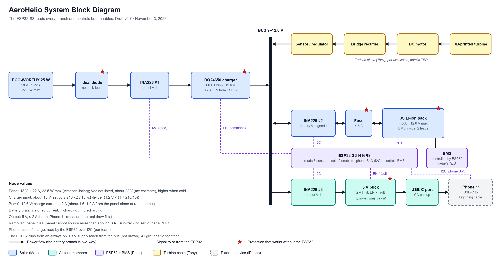

# AeroHelio Design Documentation

This directory contains system architecture diagrams and engineering design documents.

Designs are under development and may be revised following component testing and system integration.

## System Block Diagram

*System architecture draft, November 3, 2026. The design is subject to revision as hardware components are integrated and tested.*

The diagram illustrates the proposed power flow between the solar panel, wind turbine, battery storage, and regulated USB-C output.

The ESP32-S3 is intended to monitor electrical measurements through INA226 sensors and coordinate charging-related control signals.
